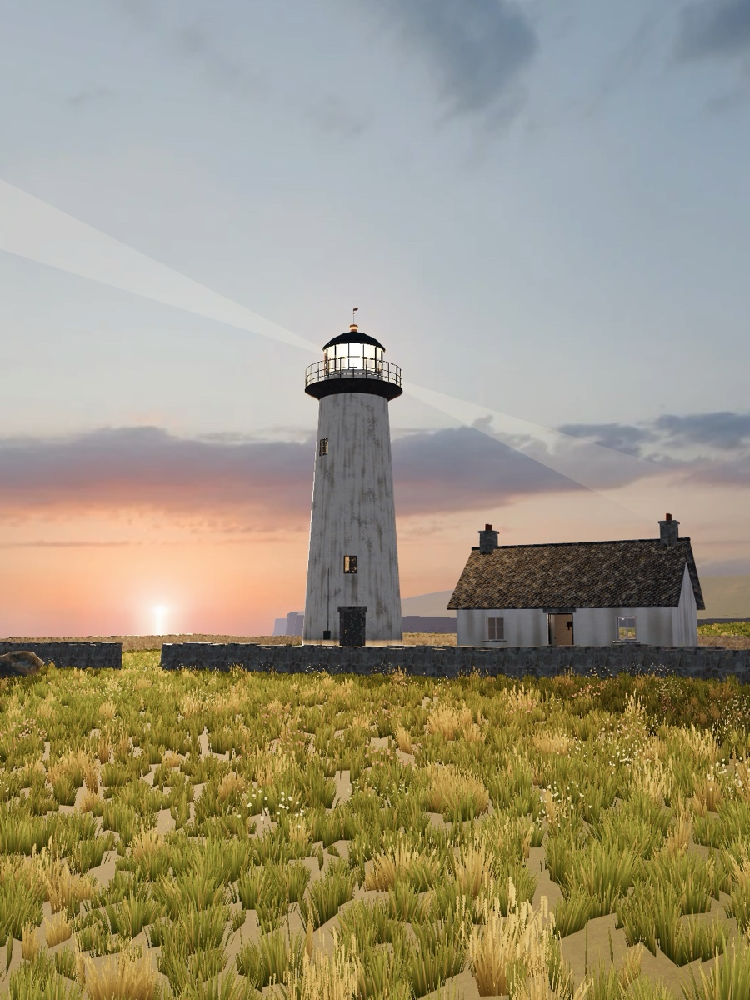
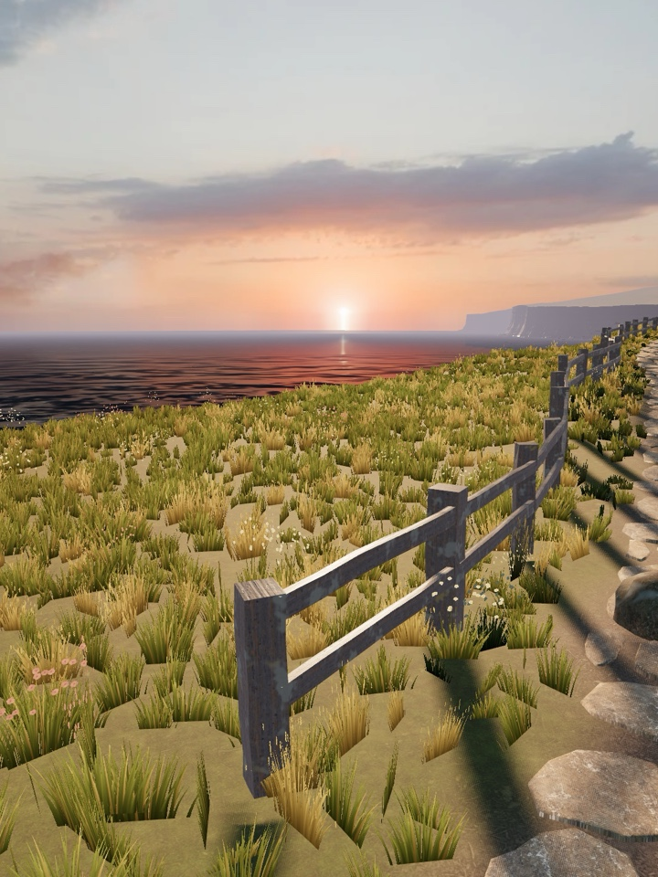
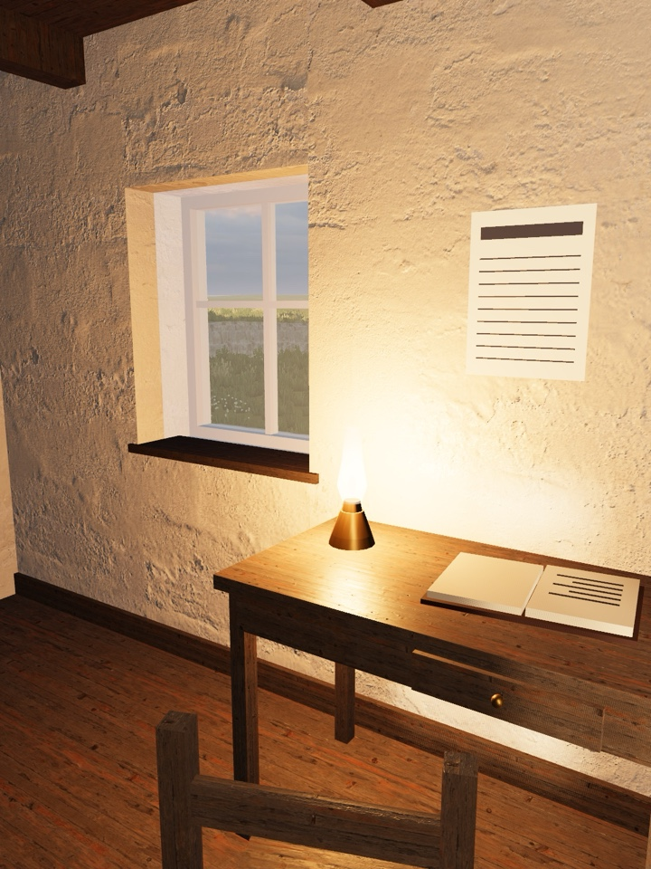
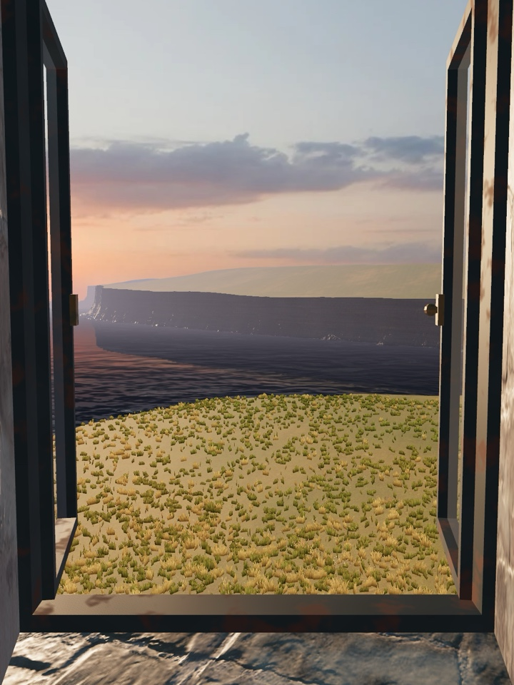
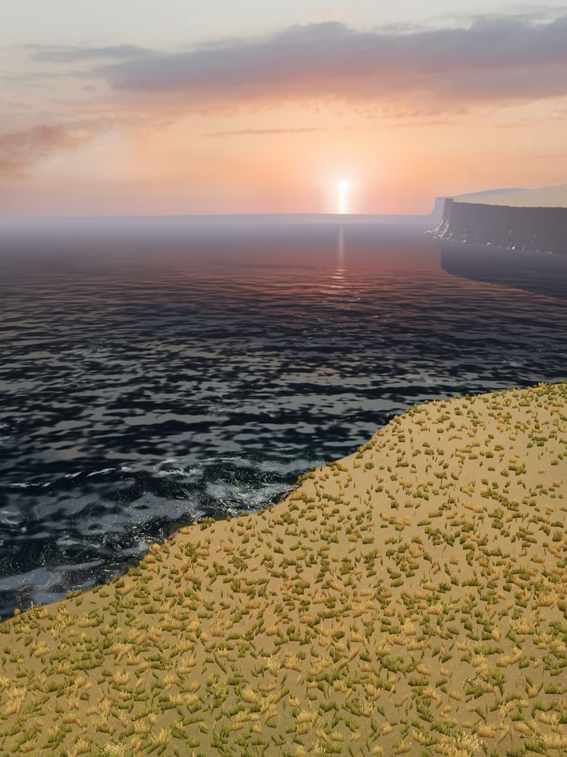

# 潮汐之间 · Between Tides（演示版）

第一人称海岸步行演示：沿旧石径走向灯塔，读几件前人留下的东西，推开栅门，替末任值守把灯点上。
Three.js 0.187 · WebGPU · TSL · Vite。

<p align="center">
  
</p>
<p align="center">落日下的灯塔和值守屋 · 游戏实机</p>

## 运行

### 直接玩

在 GitHub 打开仓库根目录的 [潮汐之间.html](./潮汐之间.html)，选择 **Download raw file** 下载。用支持 WebGPU 的桌面版 **Chrome 或 Edge** 打开本地文件，再单击画面开始。HTML 内含游戏代码和素材，可以离线玩。

### 从源码运行

需要 Node.js 20.19+ 或 22.12+：

```bash
npm ci
npm run dev
```

打开终端显示的本地地址（默认是 `http://127.0.0.1:5173/`）。macOS 也可双击 `start.command` 启动。

`npm run build` 会在 `dist/` 生成静态网页。用 `npm run preview` 可在本机预览这份构建。

## 操作

| 键 | 作用 |
| --- | --- |
| 单击画面 | 开始 / 继续（锁定鼠标） |
| W A S D | 行走 |
| Shift | 快步 |
| 空格 | 跳跃 |
| 鼠标 | 环顾 |
| E | 互动 / 收起字条 |
| F | 取景框：滚轮变焦，单击拍摄（PNG 存到下载目录） |
| Esc | 暂停 |
| P | 显示帧率和当前渲染分辨率 |

## 流程

起点 → 长椅铜牌 → 界石 → 石墙边的信箱（字条 + 钥匙）→ 推开栅门 → 灯塔院落 → 塔脚配电盒合闸 → 灯亮。
值守室可以进去：推开屋门，桌上有日志和一盏可以点亮的油灯，墙上钉着潮汐表。进屋后曝光会抬高、风声海声变闷。
灯塔也可以进去：拿到信箱里的钥匙后能打开塔门，沿内壁的螺旋石阶走到灯室，从塔顶看海；灯器上有一块铭牌可以查看，灯室里的开关也可以点亮或关掉灯塔。朝海的门洞可通往有护栏的外侧环廊，绕塔一圈后可以从原路返回。楼梯间打开窗户时，靠近能听到从窗外传来的风浪声。
不取钥匙直接到塔下，配电盒打不开。

## 实机截图

| 沿着海边石径走 | 值守屋里的油灯 |
| --- | --- |
|  |  |

| 推开高窗看海崖 | 在塔顶环廊看落日 |
| --- | --- |
|  |  |

## 结构

- `src/world/layout.js` 布局、石径曲线、地形高度函数
- `src/world/terrain.js` 地形网格与地表材质 · `grass.js` 草 · `atmosphere.js` 天空/太阳/雾/海
- `src/world/cottage.js` 值守室外壳与室内
- `src/world/lighthouse.js` 灯塔外壳、螺旋楼梯、灯室，以及上下楼的行走逻辑
- `src/world/props.js` 石板、栅栏、干砌石墙、栅门、礁石 · `structures.js` 灯塔、值守室、长椅、界石、信箱
- `src/game/` 第一人称控制、互动与流程、合成音效 · `src/ui/` 界面
- `src/vendor/` 取自 [wolffe/three.js-skills](https://github.com/wolffe/three.js-skills) 的天空、海水、草地、镜头和输入脚本（[MIT 许可](./src/vendor/LICENSE)）

## 素材

天空 EveningSkyHDRI046B 与全部贴图来自 [ambientCG](https://ambientcg.com/)（CC0）。草的卡片图集、所有模型与音效均由代码生成。

单文件 HTML 也包含 [Three.js](https://github.com/mrdoob/three.js)，其 [MIT 许可](./src/vendor/LICENSE.three) 随仓库提供。
